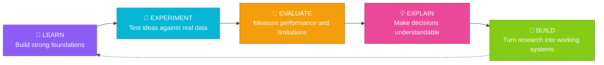

<!-- ═══════════════ HEADER ═══════════════ -->

 

  

 

<!-- ═══════════════ ABOUT ═══════════════ -->

I'm an **Artificial Intelligence and Data Science** student interested in turning research ideas into **practical, explainable, and reliable intelligent systems**.

 

My work spans machine learning, agentic AI, explainable cybersecurity, retrieval-augmented generation, robotics, and multi-agent control systems. I enjoy working across the complete problem-solving process—from understanding a problem and preparing data to implementing models, evaluating results, and building usable applications.

<table align="center">
  <tr>
    <td width="200"><b>🎯 Focus</b></td>
    <td>Machine Learning, Agentic AI, Explainable AI, NLP, and intelligent systems</td>
  </tr>
  <tr>
    <td><b>🔬 Research interests</b></td>
    <td>Cybersecurity, trustworthy AI, robotics, and autonomous systems</td>
  </tr>
  <tr>
    <td><b>🧪 Approach</b></td>
    <td>Experiment, evaluate, understand failure cases, and improve</td>
  </tr>
  <tr>
    <td><b>🌱 Currently exploring</b></td>
    <td>AI agents, explainability, and dependable AI-driven decision systems</td>
  </tr>
</table>

<!-- ═══════════════ PROJECTS ═══════════════ -->

  
  
  
  

 

<!-- ───────────── Project 1 ───────────── -->
<table>
  <tr>
    <td>

### 🛡️ 01 · Agentic AI-Based Cyber Attack Detection and Investigation

> **Explainable machine learning for cybersecurity threat analysis**

An AI-based cybersecurity project focused on detecting network attacks and supporting investigation through explainable machine learning. The project considers multiple traffic categories and combines classification with explainability to make model decisions easier to inspect.

**🔹 Key components**

- Multi-class traffic classification, including normal traffic and attack categories
- Machine learning-based attack detection
- Explainable ML to help interpret predictions and identify influential features
- Investigation-oriented analysis of suspicious network activity
- Evaluation of model behavior across different traffic classes

**🧰 Technologies** &nbsp;

</td>
  </tr>
</table>

<!-- ───────────── Project 2 ───────────── -->
<table>
  <tr>
    <td>

### 📚 02 · LegalRAG-AI

> **Retrieval-augmented generation for legal document question answering**

A legal document analysis application designed to retrieve relevant passages from uploaded documents and generate context-grounded responses. It combines semantic retrieval with language-model generation and evaluation mechanisms to help users inspect the relevance and faithfulness of generated answers.

**🔹 Key components**

- PDF extraction and clause-level document chunking
- Sentence-BERT embeddings for semantic representation
- FAISS-based similarity search and retrieval
- Context-grounded answer generation using a LLaMA model
- Relevance validation and faithfulness-oriented evaluation

**🧰 Technologies** &nbsp;

</td>
  </tr>
</table>

<!-- ───────────── Project 3 ───────────── -->
<table>
  <tr>
    <td>

### 🐜 03 · AntBot — Hexapod Surveillance Platform

> **Accessible robotic platform for surveillance research**

A hexapod robotics project exploring a multi-legged platform for surveillance applications. The work focuses on the design and experimental validation of an accessible robotic system, with emphasis on locomotion, mechanical design, and robotics concepts.

**🔹 Key areas**

- Hexapod robot platform design
- Multi-legged locomotion concepts
- Kinematics and movement planning
- Robotics for surveillance-oriented applications
- Design and experimental validation

**🧰 Technologies** &nbsp;

</td>
  </tr>
</table>

<!-- ───────────── Project 4 ───────────── -->
<table>
  <tr>
    <td>

### 🛰️ 04 · Multi-Satellite Attitude Coordination and Fault-Tolerant Control

> **Coordinated autonomous systems and control engineering**

An area of work involving multi-spacecraft attitude coordination, communication-aware control, and fault-tolerant system behavior. The focus is on understanding how distributed spacecraft can coordinate their orientation while accounting for communication constraints and potential faults.

**🔹 Key areas**

- Multi-agent and multi-spacecraft coordination
- Attitude control and system dynamics
- Fault-tolerant control strategies
- Communication-aware coordination
- Simulation-based analysis of system behavior

**🧰 Technologies** &nbsp;

</td>
  </tr>
</table>

<!-- ═══════════════ TOOLKIT ═══════════════ -->

<table align="center">
  <tr>
    <td width="270"><b>💻 Programming</b></td>
    <td>
      
      
      
      
    </td>
  </tr>
  <tr>
    <td><b>🧠 Machine Learning &amp; Explainability</b></td>
    <td>
      
      
      
      
      
    </td>
  </tr>
  <tr>
    <td><b>📖 Generative AI &amp; Information Retrieval</b></td>
    <td>
      
      
      
      
      
    </td>
  </tr>
  <tr>
    <td><b>🤖 Robotics &amp; Engineering</b></td>
    <td>
      
      
      
      
    </td>
  </tr>
  <tr>
    <td><b>🛠️ Development Tools</b></td>
    <td>
      
      
    </td>
  </tr>
</table>

<!-- ═══════════════ RESEARCH ═══════════════ -->

I am particularly interested in projects where **AI must do more than produce a prediction.**

 

<table align="center">
  <tr>
    <td width="260"><b>🛡️ Explainable cybersecurity</b></td>
    <td>Making threat detection easier to interpret and investigate.</td>
  </tr>
  <tr>
    <td><b>⚖️ Trustworthy language models</b></td>
    <td>Improving retrieval quality, grounding, and answer evaluation.</td>
  </tr>
  <tr>
    <td><b>🦿 Autonomous robotics</b></td>
    <td>Exploring locomotion, coordination, and control.</td>
  </tr>
  <tr>
    <td><b>🛰️ Distributed intelligent systems</b></td>
    <td>Studying communication-aware coordination and fault tolerance.</td>
  </tr>
  <tr>
    <td><b>📊 Applied machine learning</b></td>
    <td>Comparing methods carefully and reporting results based on actual experiments.</td>
  </tr>
</table>

> My goal is to build systems that are not only **functional**, but also **measurable, understandable, and useful** in real applications.

<!-- ═══════════════ DIRECTION ═══════════════ -->

I enjoy collaborating on meaningful technical projects, learning new tools through implementation, and exploring ideas that connect research with practical engineering.

<!-- ═══════════════ BUILDING PHILOSOPHY ═══════════════ -->

I approach every project with a focus on **solving a meaningful problem, validating ideas through experimentation, and creating systems that are understandable and useful beyond the prototype.**

<table align="center">
  <tr>
    <td width="33%" valign="top" align="center">

**🎯 Problem First**

Start with the real-world need, define the problem clearly, and choose methods that fit the task.

</td>
    <td width="33%" valign="top" align="center">

**📊 Evidence Driven**

Evaluate with relevant metrics, examine limitations, and let experimental results guide improvements.

</td>
    <td width="33%" valign="top" align="center">

**🚀 Practical Outcomes**

Bring models, software, and engineering together to develop solutions that can be tested and used.

</td>
  </tr>
</table>

<!-- ═══════════════ CONNECT ═══════════════ -->

  

### ✨ Build with purpose. Research with curiosity. Engineer with clarity. ✨

AI • Data Science • Cybersecurity • NLP • Robotics • Intelligent Systems

<!-- ═══════════════ FOOTER ═══════════════ -->

